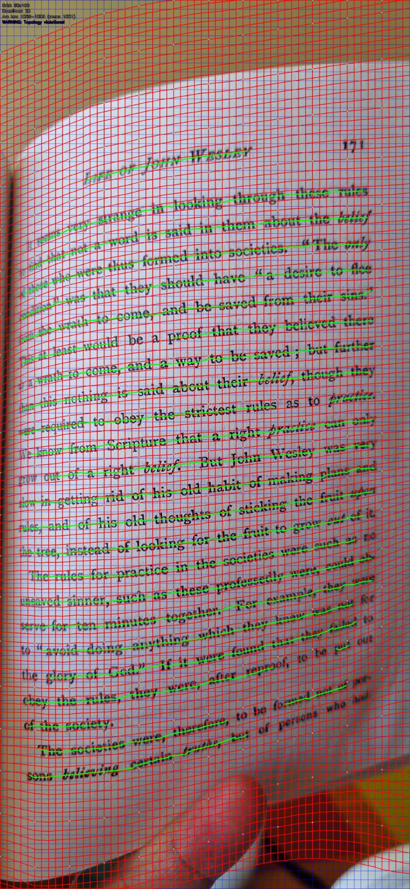

# MeshDewarp

Document dewarping pipeline for Android using mesh-based polynomial grid correction.

> **Status: prototype, not shipped.** Developed in January 2026 inside the [RecallReader](https://github.com/shannonbay/RecallReader) Android app and removed from it in October 2026 when the app went Bible-only. The source here is not a standalone build: it has no Gradle project, and the TFLite model files are not included.

  
   
  <em>Debug view from <code>TopologicalGridOverlay</code>: detected text baselines (green) and the fitted correction grid (red) on a curved page.</em>

## Overview

MeshDewarp straightens curved or warped pages in photographs of documents. It uses a multi-stage pipeline:

1. **Document boundary detection** — DBNet model identifies text regions
2. **Control point extraction** — Identifies grid control points along detected text lines
3. **Polynomial grid dewarping** — Fits polynomial curves to control points and generates a correction mesh
4. **Spline splicing** — B-spline curve fitting for smooth interpolation between control points
5. **Topological grid overlay** — Visualization and debugging of the correction grid

## Source Files

- `DBNetModel.kt` — TensorFlow Lite inference for document boundary detection
- `DewarpProcessor.kt` — Main pipeline orchestrator with configurable output modes (dewarp, grid overlay, etc.)
- `ExtractControlPointsUtil.kt` — Extracts control points from detected text line contours
- `PolynomialGridDewarp.kt` — Polynomial-based mesh dewarping with sparse grid optimization
- `SplineSplicer.kt` — B-spline curve fitting for smooth grid interpolation
- `TopologicalGridOverlay.kt` — Grid visualization for debugging
- `YoloSegmentationModel.kt` — YOLO segmentation model integration
- `ImageUtils.kt` — Image utility functions (orientation fix, gallery save, etc.)

## Dependencies

- TensorFlow Lite 2.14.0 (with GPU and NNAPI delegates)
- OpenCV 4.10.0

## Origin

Extracted from the [RecallReader](https://github.com/shannonbay/RecallReader) Android app.
